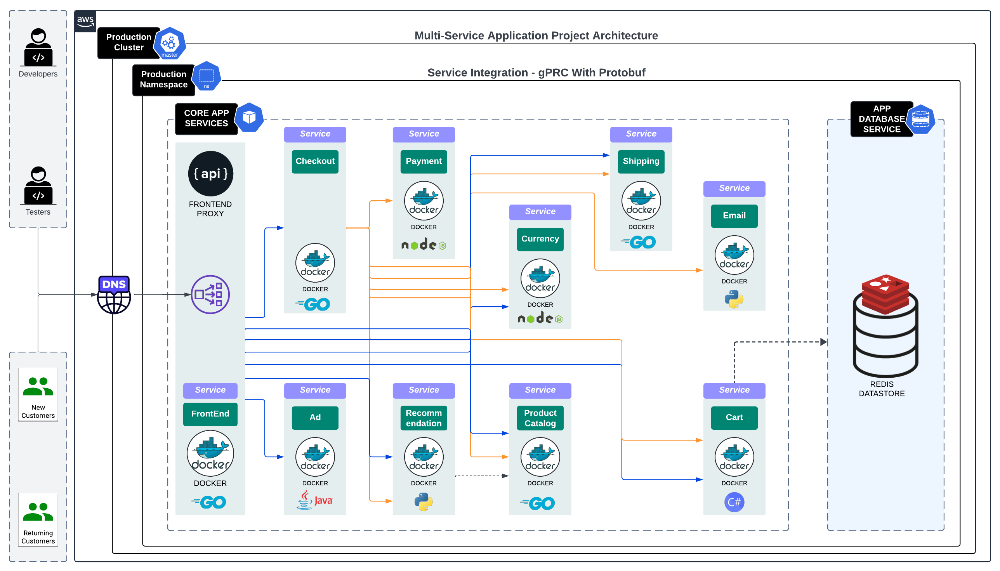

# Boutique Platform

Boutique Platform is a monorepo containing the Online Boutique microservices application, its Kubernetes deployment manifests, CI/CD configuration, shared protocol definitions, architecture documentation, and repository validation tooling. The repository organizes all 12 application and infrastructure services under `src/` and provides separate Kubernetes configurations for the `test-env` and `prod-env` environments.

## Architecture



## Repository Layout

```text
boutique-platform/
├── .github/
│   └── workflows/
│       └── ci.yml
├── docs/
│   └── images/
│       ├── architecture.png
│       ├── cicd-pipeline-1.png
│       └── cicd-pipeline-2.png
├── kubernetes/
│   ├── test-env/
│   │   ├── adservice/
│   │   ├── cartservice/
│   │   ├── checkoutservice/
│   │   ├── currencyservice/
│   │   ├── emailservice/
│   │   ├── frontend/
│   │   ├── loadgenerator/
│   │   ├── paymentservice/
│   │   ├── productcatalogservice/
│   │   ├── recommendationservice/
│   │   ├── redis/
│   │   ├── shippingservice/
│   │   └── namespace.yaml
│   └── prod-env/
│       ├── adservice/
│       ├── cartservice/
│       ├── checkoutservice/
│       ├── currencyservice/
│       ├── emailservice/
│       ├── frontend/
│       ├── loadgenerator/
│       ├── paymentservice/
│       ├── productcatalogservice/
│       ├── recommendationservice/
│       ├── redis/
│       ├── shippingservice/
│       └── namespace.yaml
├── protos/
│   └── demo.proto
├── scripts/
│   ├── import_services.sh
│   └── validate_layout.sh
├── src/
│   ├── adservice/
│   ├── cartservice/
│   ├── checkoutservice/
│   ├── currencyservice/
│   ├── emailservice/
│   ├── frontend/
│   ├── loadgenerator/
│   ├── paymentservice/
│   ├── productcatalogservice/
│   ├── recommendationservice/
│   ├── redis/
│   └── shippingservice/
├── LICENSE
└── README.md
```

## Services

| Folder | Language | Container Port |
|---|---|---:|
| `adservice` | Java | 9555 |
| `cartservice` | C# / .NET | 7070 |
| `checkoutservice` | Go | 5050 |
| `currencyservice` | JavaScript / Node.js | 7000 |
| `emailservice` | Python | 8080 |
| `frontend` | Go | 8080 |
| `loadgenerator` | Python | N/A |
| `paymentservice` | JavaScript / Node.js | 50051 |
| `productcatalogservice` | Go | 3550 |
| `recommendationservice` | Python | 8080 |
| `redis` | Redis data store | 6379 |
| `shippingservice` | Go | 50051 |

`loadgenerator` does not expose a `containerPort` in its Kubernetes deployment; it generates traffic toward the frontend.

## Validate the Repository Layout

Run the repository validator from the repository root:

```bash
./scripts/validate_layout.sh
```

A valid repository should report:

```text
Layout OK: 12 services, 48 manifests
```

The validator checks required Dockerfiles and Jenkinsfiles, Kubernetes deployments and namespaces, legacy `deploy-envs` directories, committed `.env` files, and files larger than 20 MB.

## Known Follow-ups

- The Jenkinsfiles still point at `deploy-envs/...` paths and must be updated before Jenkins can build from this monorepo.